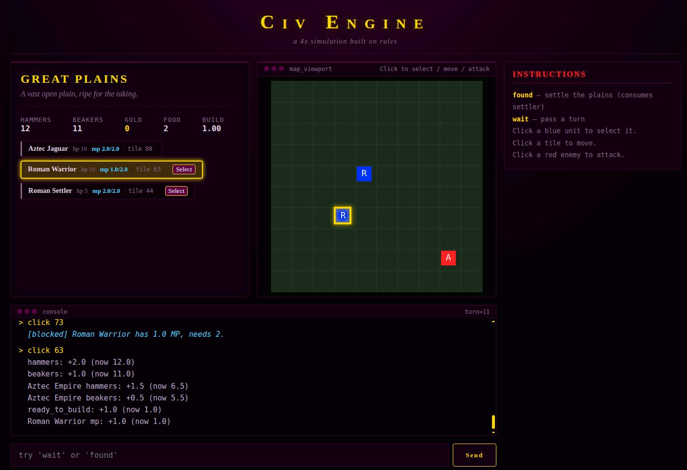

# Glop Engine

A deterministic, rule-driven simulation kernel for turn-based and
real-time strategy games. The engine itself knows nothing about units,
cities, or combat &mdash; it knows about **entities**, **rules**, **events**,
**actions**, and **transactions**. Everything above that is data.

Glop is designed for games where the simulation must be:

- **Deterministic** &mdash; the same inputs produce the same state, every time.
- **Transactional** &mdash; every tick commits atomically or rolls back.
- **Data-driven** &mdash; new game mechanics are added by editing JSON, not Python.
- **Projectable** &mdash; the same tick can be rendered as text, 2D, or 3D
  through a read-only projection layer without touching the engine.
- **Inspectable** &mdash; every state change is journaled, so the why of a
  result is always recoverable after the fact.

---

<!-- GIF SPLASH &mdash; upload the file to ./assets/ and update the src below -->
The included game is not playable but is meant to demonstrate that engine mechanics work
<p align="center">
  
</p>
<!-- END GIF SPLASH -->

---

## Contents

- [What Glop Is](#what-glop-is)
- [What Glop Is Not](#what-glop-is-not)
- [Core Concepts](#core-concepts)
  - [Entity](#entity)
  - [Stats, Rates, and Statuses](#stats-rates-and-statuses)
  - [Rule](#rule)
  - [Event](#event)
  - [Action](#action)
  - [Transaction and Journal](#transaction-and-journal)
  - [Scheduler](#scheduler)
- [The Tick](#the-tick)
- [Condition Language](#condition-language)
- [Action Reference](#action-reference)
- [The Shadow Interface](#the-shadow-interface)
- [Persistence](#persistence)
- [Hosting a Game](#hosting-a-game)
- [Minimal Test Game](#minimal-test-game)
- [Design Constraints and Trade-offs](#design-constraints-and-trade-offs)
- [Extending the Engine](#extending-the-engine)
- [Directory Layout](#directory-layout)

---

## What Glop Is

Glop is a **simulation kernel**, not a game framework. It provides:

1. An entity store with indexed queries by container, kind, and tag.
2. A rules engine that fires on named events and evaluates a small
   boolean condition language against entity state.
3. A staged-action pipeline where every tick s mutations are queued,
   sorted deterministically, and committed atomically in a single
   transaction.
4. A journal of every change (old value, new value, entity, stat) that
   downstream code can read to project the tick into another form.
5. A scheduler that fires events at a world-time offset, which is how
   turn clocks, cooldowns, and production cycles are expressed.
6. A persistence layer that serializes and restores the entire engine
   state &mdash; including the scheduler &mdash; to a SQLite store.

Everything else (units, cities, terrain, combat, economies) is content.
The same engine can host a dungeon crawler, a 4X game, a roguelike, or a
puzzle, because none of those nouns appear anywhere in engine.py.

## What Glop Is Not

- **Not a renderer.** It has no concept of pixels, tiles, cameras, or
  animation. A separate Shadow module translates the engine s journal
  into renderer-friendly events and hints.
- **Not a physics engine.** Movement is discrete and rule-driven. There
  is no collision solver, no continuous integration, and no interpolation.
- **Not a scripting language.** The condition language is intentionally
  small: arithmetic, comparison, boolean operators, entity attribute
  access, and one built-in function (distance). Anything more complex
  belongs in a rule or in the host s action queue.
- **Not multi-tenant.** A single Engine instance holds a single world.
  Hosting multiple players means running multiple engines or sharding
  by container.
- **Not a database.** Persistence is an opaque snapshot; the engine
  loads it into memory and does all work there.

---

## Core Concepts

### Entity

An **entity** is a dictionary with a stable id and the following shape:

```json
{
  "id": "unit_rome_warrior_1",
  "kind": "unit",
  "name": "Roman Warrior",
  "tags": ["military", "melee", "roman"],
  "loc": { "container": "plains_1", "pos": { "tile": 15 } },
  "stats": { "hp": 10, "hp_max": 10, "mp": 2.0, "mp_max": 2.0 },
  "rates": { "hammers": 0.0 },
  "status": [],
  "rules": []
}
```

| Field | Required | Meaning |
|---|---|---|
| id | yes | Unique string key in engine.ents. |
| kind | no | Coarse classifier: unit, city, player, environment. Host-defined. |
| name | no | Display name. Defaults to id if absent. |
| tags | no | List of strings used for queries and by the condition language. |
| loc | no | container and pos, where pos is a dict of numeric axes (tile, x, y). |
| stats | no | Numeric fields. Written by modify_stat, read by conditions. |
| rates | no | Per-tick continuous contributions to stats. |
| status | no | Active timed effects. Managed by apply_status. |
| rules | no | List of trigger, condition, action dicts. |

The engine does not enforce a schema. If a field is absent, defaults are
supplied on load (rates = {}, status = [], stats = {}, rules = []).

### Stats, Rates, and Statuses

Three layers of numeric state:

- **stats** &mdash; instantaneous values. Written by modify_stat and by any
  host code calling engine.execute_action(...) with a modify_stat action.
- **rates** &mdash; continuous per-second contributions. Every integrate(dt)
  adds rate * dt to the corresponding stat, as a journaled stat change.
  Use rates for income, regen, decay, or anything that should accrue
  smoothly over time.
- **status** &mdash; active effects with a duration and optional rate. A
  status rate is added to engine.rates[stat] while it is active and
  removed when it expires.

Rates and statuses are how you express accumulate over time without
scheduling an event per tick. Use scheduled events for one-shot
transitions (production complete, cooldown ready), and rates for
continuous quantities (gold per second, MP regen, starvation).

### Rule

A **rule** is a triple:

```json
{
  "trigger": "production_complete",
  "condition": "target == self and stats.hammers >= 10",
  "action": { "type": "spawn", "ent": { } }
}
```

- **trigger** &mdash; a named event. When that event is dispatched, every
  entity that has a rule with that trigger is visited and its
  condition is evaluated.
- **condition** &mdash; a boolean expression in the condition language.
  Evaluated at dispatch time, against live state. If it does not parse,
  the rule does not fire and a warning is printed.
- **action** &mdash; the action to stage if the condition is true. Staged
  actions are committed together at the end of the tick.

Rules are indexed by trigger. Adding or removing a rule on an entity
updates the index incrementally; the index can be rebuilt from scratch
with engine._rebuild_index() if it ever drifts.

### Event

An **event** is a named string (tick, attack, found_city,
production_complete, or anything the content defines). Events are
dispatched by three sources:

1. **engine.integrate(dt)** &mdash; the tick fires automatically.
2. **engine._input_queue** &mdash; inputs queued by the host (or by an
   InputBridge) are drained at the end of each tick.
3. **engine.dispatch_event(name, source, context)** &mdash; the host can
   dispatch an event immediately, bypassing the queue.

Every entity with a rule whose trigger matches the dispatched event
name is visited, its condition is evaluated, and its action is staged if
true. Conditions are evaluated against live state at dispatch time, but
actions do not run until commit. This is the most important semantic
in the engine.

### Action

An **action** is a dict with a type field. The engine ships with ten:

- modify_stat &mdash; additive change to a stat.
- move_toward &mdash; step an entity positional axis toward another entity.
- move_to &mdash; teleport an entity to a tile.
- apply_status &mdash; add a timed effect with an optional rate.
- add_rate &mdash; modify an entity continuous rate.
- schedule &mdash; queue an event at world_time + in.
- destroy &mdash; remove an entity.
- spawn &mdash; create an entity from an inline template.
- move_container &mdash; change the entity container.
- emit &mdash; dispatch another event immediately.

See Action Reference for fields and validation.

### Transaction and Journal

Every call to integrate(dt) creates a Transaction. The transaction:

- Holds a list of PendingActions, each with a priority, a monotonically
  increasing sequence number, the source entity, the action, and a
  context dict.
- Writes changes to engine.ents immediately. This is why dispatch-time
  conditions see partially-updated state &mdash; see The Tick.
- Journals each change as (kind, path, old_value) where kind is one of
  stat, rate, pos, container, insert, delete, world_time, sched_push, or
  sched_pop.
- On success, commits: sorts pending by (priority, seq) and applies each
  action via _apply_action.
- On exception, rolls back: walks the journal in reverse, restoring each
  old value, and reports whether the tick had made any mutations.

The journal is also the projection surface for the Shadow module. The
shadow consumes the ordered journal and emits semantic events and render
hints without ever touching the engine internals.

### Scheduler

The scheduler is a heap of (at, seq, event, target, context) tuples.
Every tick, after advancing world_time, the engine pops all entries
with at <= world_time and dispatches each as an event. Entries whose
target no longer exists are silently dropped.

schedule(in=1.0, event=production_complete, target=city_rome) means one
world-second from now, fire production_complete on city_rome. The context
dict carried in the schedule entry is passed through to the dispatched
rules as the event context, which is how cross-faction guards like
target == self are expressed.

---

## The Tick

engine.integrate(dt) proceeds in seven phases. Understanding the order
is essential to writing correct rules.

### Phase 1 &mdash; Rate application

For every entity, every nonzero rate is added to the corresponding stat
as stat += rate * dt, and the change is journaled. This happens before
any event dispatch, so a rate is always applied before the tick rules see
the stat.

### Phase 2 &mdash; Advance world time

world_time is set to world_time + dt and journaled.

### Phase 3 &mdash; Scheduler drain

The engine pops scheduler entries whose at <= world_time and dispatches
each as an event. Dispatch visits every entity with a rule on that
trigger, evaluates its condition against live state, and stages its
action if true.

Staged actions do not run yet. They sit in txn.pending until commit.
This means all scheduled events in a tick dispatch against the same
pre-commit state &mdash; a rule fired by one scheduled event does not see the
side effects of another scheduled event rules. This is why the condition
language needs explicit existence checks (distance(id) < 99 for exists,
distance(id) > 99 for absent) rather than reading a just spawned flag &mdash;
those flags would not be visible during dispatch.

### Phase 4 &mdash; Status expiry

Active statuses have their duration decremented by dt. Any status whose
duration is <= 0 is removed, and its rate (if any) is subtracted from
engine.rates so it no longer contributes to the next tick.

### Phase 5 &mdash; Tick event

tick is dispatched with context {dt: dt}. This is where most per-tick
logic lives: regen, auto-combat, death checks, and per-tick state
machines. Conditions see the fully rate-applied, time-advanced state, but
no staged actions from phases 3 or 5 have been applied yet.

### Phase 6 &mdash; Input drain

Any entries in engine._input_queue are dispatched in order. Each entry is
{event: name, source: source_id, actor: actor_id, data: { }} and the
engine merges data into the event context. This is the path the host uses
to deliver player inputs, and it is the last point before commit at which
new actions can be staged.

### Phase 7 &mdash; Commit

txn.pending is sorted by (priority, seq) &mdash; priority defaults to 50, and
seq is assigned at staging time &mdash; and each action is applied in order via
_apply_action. This is the only phase in which actions have their side
effects.

If any phase raises, the transaction rolls back and integrate re-raises.
The exception types are:

- EmitDepthExceeded &mdash; an emit chain exceeded MAX_EMIT_DEPTH (8).
- SchedulerOverflow &mdash; a single tick drained more than
  MAX_SCHED_EVENTS_PER_TICK (1000) scheduled entries.

### Summary table

| Phase | Dispatch? | Apply? | Sees rate change? | Sees previous dispatch s actions? |
|---|---|---|---|---|
| 1 Rates | &mdash; | writes stats | &mdash; | &mdash; |
| 2 Time | &mdash; | sets world_time | yes | &mdash; |
| 3 Scheduler | yes | stages only | yes | no |
| 4 Status | &mdash; | removes/restores rates | yes | &mdash; |
| 5 Tick | yes | stages only | yes | no |
| 6 Inputs | yes | stages only | yes | no |
| 7 Commit | &mdash; | applies everything | yes | yes (within seq order) |

The takeaway: **within a tick, conditions always see the pre-commit
state. Across ticks, they see everything from the previous commit.**

---

## Condition Language

Conditions are Python expressions parsed with ast.parse(..., mode='eval')
and evaluated by Engine.eval_ast. Supported constructs:

### Literals and names
- Numeric and string literals: 10, "400", 2.0.
- true / false &mdash; booleans.
- self &mdash; the id of the entity whose rule is firing.
- A bare name that matches an entity id resolves to that entity dict
  if it exists, or to source_ent.stats.get(name, 0.0) if it does not.
  This dual behavior is used for the existence idiom (distance(id) > 99).
- A bare name that matches a context key resolves to the context value.

### Attribute access
- self.stats.hp &mdash; the firing entity hp stat.
- city_rome_city.stats.hp &mdash; another entity stat.
- target.stats.hp &mdash; the stat of whatever target is (usually a
  context value or a resolved entity id).
- context.foo is not supported. Use the bare name foo instead;
  eval_ast will fall back to context["foo"] if it is present.

### Operators
- Arithmetic: +, -, *, /.
- Comparison: <, >, <=, >=, ==, !=.
- Boolean: and, or.

not is not supported. Use != to express negation:
target != self means target is not self. id != 0 means id
exists.

### Function
- distance(<entity_id>) &mdash; the Euclidean distance between the firing
  entity and the named entity. Returns float('inf') if the named
  entity does not exist, so distance(id) > 99 is the standard
  does not exist or is very far check, and distance(id) < 99 is the
  standard exists and is nearby check.

Any other function call returns float('inf')

### Idioms
| Intent | Expression |
|---|---|
| Entity exists | distance(<id>) < 99 |
| Entity absent | distance(<id>) > 99 |
| Enemy is adjacent | distance(<enemy_id>) < 2 |
| Is this me? | target == self |
| Is this NOT me? | target != self |
| Stat below threshold | stats.hp < stats.hp_max |

If you need a condition the language cannot express, the correct
response is a new entity, a new stat, or a new small action &mdash; not a
larger expression.

---

## Action Reference

All actions are dicts with a type and, depending on the type, required
fields. Validation runs at stage time via _validate_action, so a
malformed action fails the tick before any of its side effects commit.

### modify_stat
Add value to stat on target. value must be numeric.
```json
{ "type": "modify_stat", "target": "self", "stat": "mp", "value": "-1" }
```

### move_toward
Step source positional axis toward target by up to speed.
```json
{ "type": "move_toward", "target": "unit_rome_warrior_1", "speed": 1 }
```

### move_to
Set target tile axis to tile.
```json
{ "type": "move_to", "target": "self", "tile": 15 }
```

### apply_status
Add a timed effect with an id, duration, and optional rate.
```json
{ "type": "apply_status", "target": "self", "status_id": "poison",
  "duration": 5.0, "rate": { "hp": -1.0 } }
```

### add_rate
Modify target continuous rates by a dict of deltas.
```json
{ "type": "add_rate", "target": "self", "rate": { "hammers": 1.0 } }
```

### schedule
Queue an event at world_time + in for target, carrying context.
```json
{ "type": "schedule", "in": 1.0, "event": "production_complete",
  "target": "city_rome_city", "context": { "target": "city_rome_city" } }
```

The context dict is preserved through dispatch and is how cross-faction
guards like target == self are expressed. If you schedule an event
whose rules use target == self, you must set context.target to the
recipient id. Otherwise target will be None and the guard will
silently fail.

### destroy
Remove target from the engine.
```json
{ "type": "destroy", "target": "self" }
```

### spawn
Create a new entity from an inline template. If the template id is
already present, the spawn is skipped (logged, not raised).
```json
{ "type": "spawn", "ent": { "id": "...", "kind": "unit", ... } }
```

### move_container
Move target to a different container. Maintains the container index.
```json
{ "type": "move_container", "target": "self", "container": "forest_1" }
```

### emit
Immediately dispatch another event with a nested context. Depth is
limited by MAX_EMIT_DEPTH (8).
```json
{ "type": "emit", "event": "build_phase", "target": "self" }
```

Caveat: emit does not merge action.target into the dispatched
context. If the emitted event rules use target, pass it through
context (which the action supports but which is rarely used). In
practice, direct modify_stat on a literal entity id is preferred over
emit for tick-based logic, because it avoids this footgun entirely.

---

## The Shadow Interface

Shadow is a **read-only projection** over the engine transaction
journal. It does not mutate the engine and does not require the engine
to know anything about rendering.

```python
from shadow import Shadow

shadow = Shadow(engine)
txn = engine.integrate(1.0)
shadow.consume(txn)

for ev in shadow.frame_events():
    # ENTITY_SPAWNED, ENTITY_MOVED, ENTITY_DAMAGED, ENTITY_HEALED,
    # ENTITY_DIED, STAT_CHANGED, STATUS_APPLIED, STATUS_EXPIRED,
    # CONTAINER_CHANGED, SCHEDULER_UPDATED, TICK_ADVANCED
    ...

for hint in shadow.render_hints():
    # damage_flash, floating_damage_number, spawn_effect,
    # death_effect, sound_cue
    ...

text_lines = shadow.narrative(perspective="rome")
```

Three principles govern the shadow:

1. **No deduplication.** If a tick produces five damage events on the
   same entity, the shadow reports five events. Merging them would lose
   information a renderer might want (five separate flash triggers, five
   separate sound cues).
2. **No engine knowledge.** The shadow only knows the journal vocabulary
   (stat, pos, container, insert, delete, sched_push, sched_pop) and the
   meaning of the hp stat. If you add a new stat that should produce a
   specific visual, extend the shadow &mdash; do not extend the engine.

The narrative(perspective) method is a human-readable filter over the
frame events. It is used by the harness to produce the text log and is
not required by any renderer. It skips movement and scheduler churn to
reduce noise.

---

## Persistence

Engine.save(store) serializes the entire engine state &mdash; entities,
containers, world time, and the scheduler heap &mdash; into a GameStore
(SQLite by default). Engine.load(store) reconstructs an engine from
that snapshot, including the rule index and container index, without
re-parsing ents.json or containers.json.

Because the scheduler is part of the snapshot, a save mid-build
resumes the build on load. This is why the engine has no turn counter
separate from world_time &mdash; the world time is the turn counter,
and it is saved.

The store interface is three methods (exists, save, load). Any
storage that can round-trip a dict of engine state can be swapped in.

---

## Hosting a Game

The engine is transport-agnostic. The canonical pattern is:

1. Load an Engine from ents.json and containers.json (or from a save).
2. Read input from the host (a terminal, an HTTP request, a socket).
3. Deliver the input to the engine via engine._input_queue.append
4. Advance the simulation with engine.integrate(dt).
5. Project the resulting state to the host.

The engine ships with a minimal InputBridge that validates source and
actor against a configured set of allowed sources and dispatches the
input on the engine behalf. It is intentionally thin; most hosts will
either use it directly or bypass it and call engine._input_queue.append
with the same payload shape:

```python
engine._input_queue.append({
    "event": "attack",
    "source": "rome",
    "actor": "unit_rome_warrior_1",
    "data": {"target": "city_tenochtitlan_city"},
})
```

The payload shape is part of the engine public contract. The
engine merges {source: ..., actor: ..., **data} into the event
context before dispatch, so an action condition can reference
target (from data) directly.

---

## Minimal Test Game

The repository ships with one example game under
[games/dungeon_crawler/](games/dungeon_crawler/). It is a minimal playable 4X skirmish used to
exercise the engine features:

- **Two factions** (Rome and Aztec), each with a starting capital.
- **Cities** that accumulate production and spawn units (warriors,
  jaguars, settlers).
- **Player-chosen production** via a choose command, with auto-advance
  on completion (a city_production_complete event).
- **Combat** via tick-range auto-attack and via explicit attack
  events, with a check_death cleanup pass.
- **Victory** by destroying every enemy unit and city, surfaced as a
  banner in the web UI.
- A **12x12 map** with positions chosen so the two capitals are
  reachable in about a dozen turns.

The example is not a template. It is a fixture &mdash; its purpose is to prove
that the engine can host a complete, winnable session with no engine
changes. Anything in games/dungeon_crawler/ (including the Flask web
harness and the 2D canvas renderer) is optional and can be replaced
without touching engine.py.

To run it:

```bash
pip install flask
python games/dungeon_crawler/main.py
# open http://127.0.0.1:5000
```

See games/dungeon_crawler/README.md for commands and mechanics.

---

## Design Constraints and Trade-offs

These are deliberate choices, not oversights. Changing any of them is a
significant engine change, not a bug fix.

### No set_stat

There is no action that sets a stat to an absolute value. Set to zero
is expressed as a large negative modify_stat, and set to max is
expressed as a guarded modify_stat that never overshoots because its condition checks stat < max. This is intentional: absolute sets are
easy to misuse and hard to roll back meaningfully. If you find yourself
needing one, the correct fix is usually a new stat or a different guard.

### Unclamped modify_stat

Stats can go negative or exceed their nominal maxima. There is no
generic clamp. Content is responsible for bounding its own values
through guards (stats.hp > 0 before damage, stats.mp < stats.mp_max
before regen). Clamping would make the tick journal inconsistent with
what the rules observe at dispatch time.

### Staged actions, live conditions
Conditions see pre-commit state. This is the trade-off that makes the
scheduler fan-out behavior observable: if two scheduled events fire in
the same tick, neither sees the other spawned entities. Content that
needs cross-event coordination must use existence checks and per-tick
state machines rather than shared flags. See The Tick.

### not is not a keyword
Negation is expressed by != on entities (target != self) and by
choosing the complementary comparison (distance(id) > 99 for absent).
This is a deliberate limitation of the condition parser; adding not
would require a proper boolean parser and would invite complex nested
expressions that are hard to debug.

### Entity ids are content responsibility

The engine does not generate unique ids. The spawn action skips if the
id already exists. Content that needs repeated spawns must pre-register
a pool of ids (e.g., warrior_1, warrior_2, warrior_3) and spawn
them in order, or extend the engine with an id-sequence stat (a
significant change).

### One action per rule
A rule has one action. Multi-step behaviors are expressed as multiple
rules with the same trigger and condition. They are staged in rule-list
order and committed in (priority, seq) order, so they behave as a
sequence &mdash; but each sees the pre-commit state of the others stats.

### No context reads in conditions

The condition language reads context only via bare name fallback. You
cannot write context.target &mdash; use target, which will resolve to
context["target"] if it is present, or source_ent.stats.get("target", 0.0)
if it is not.

---

## Extending the Engine

If you outgrow the engine primitives, here are the extensions that
retain its design:

- **set_stat action** &mdash; 5 lines in _apply_action, plus a validation
  entry. Useful for exact resets and for any content that needs set to
  a specific value. The cost is that a bad value is not observable at
  dispatch time.
- **Generic clamp** &mdash; a small STAT_CLAMPS map in _apply_action's
  modify_stat branch, keyed by stat name. Content adds mp_max,
  hp_max, and similar paired stats and the engine clamps after every
  write.
- set_stat action &mdash; 5 lines in _apply_action, plus a validation
  entry. Useful for exact resets and for any content that needs set to
  a specific value. The cost is that a bad value is not observable at
  dispatch time.
- **Generic clamp** &mdash; a small STAT_CLAMPS table in _apply_action's
  modify_stat branch, keyed by stat name. Content adds mp_max,
  hp_max, and similar paired stats and the engine clamps after every
  write.
- **emit with target to context** &mdash; one line in _apply_action's
  emit branch: new_ctx.setdefault("target", action.get("target")).
  Closes the gap where tick-emitted attacks have no target.
- **Unique id generation** &mdash; add a next_id counter to the faction's
  stats, read it in the spawn template's id via a new format action,
  and increment it. This is the largest of the proposed changes and
  should be done only when content genuinely needs unbounded spawning.

Each of these is a small, localized addition. None requires a redesign.
The engine shape &mdash; journal, transaction, scheduler, dispatch &mdash; is
stable, and the extensions compose with it rather than replacing it.

---

## Directory Layout

```
dev/glop/
├── engine.py                 # the simulation kernel
├── input_bridge.py           # optional input validation/dispatch helper
├── persistence.py            # GameStore (SQLite snapshot)
├── shadow.py                 # read-only projection over the journal
├── README.md                 # this file
├── assets/
│   └── glop-splash.gif       # splash image (upload separately)
└── games/
    └── dungeon_crawler/      # minimal test game
        ├── README.md
        ├── main.py           # Flask web harness
        ├── ents.json         # content: factions, cities, units, clock
        ├── containers.json   # content: containers and their bounds
        ├── test_shadow.py    # data/engine invariant smoke test
        └── templates/
            ├── index.html
            ├── style.css
            └── 2drender.js
```

The engine has no imports from any game. Every game imports the engine.
Any file inside games/ can be deleted and the engine still runs.
